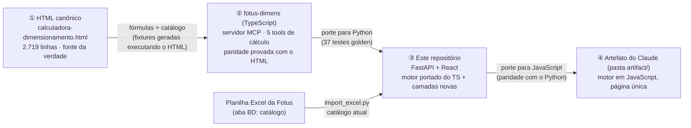
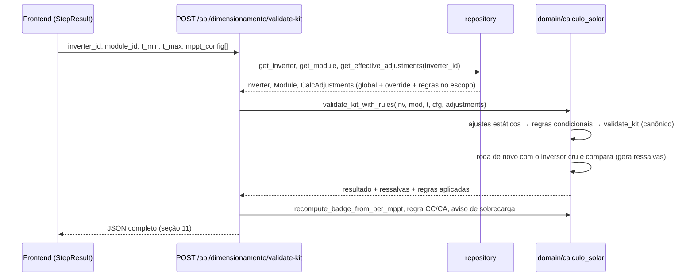

# Arquitetura da Calculadora de Dimensionamento Fotus

Documento para o time de desenvolvimento que vai incorporar a calculadora à nova plataforma de vendas da Fotus. Objetivo: quem ler este arquivo e o código deve entender **o que cada peça faz, de onde veio cada regra, o que é garantido e o que não é**, e saber onde mexer sem quebrar o resultado.

> Convenção: tudo que está aqui foi conferido no código deste repositório ou nos dois projetos de origem. Quando uma informação vem de documentação de outro projeto e não foi reexecutada aqui, o texto diz isso ("segundo o README do fotus-dimens").

## Sumário

1. [Os três artefatos e como se relacionam](#1-os-três-artefatos-e-como-se-relacionam)
2. [Quem é quem: diferenças entre os três](#2-quem-é-quem-diferenças-entre-os-três)
3. [Artefato 1: a calculadora HTML canônica](#3-artefato-1-a-calculadora-html-canônica)
4. [Artefato 2: o projeto TypeScript `fotus-dimens` (servidor MCP)](#4-artefato-2-o-projeto-typescript-fotus-dimens-servidor-mcp)
5. [Artefato 3: este repositório (Python + React)](#5-artefato-3-este-repositório-python--react)
6. [O motor de cálculo, passo a passo](#6-o-motor-de-cálculo-passo-a-passo)
7. [Camadas de negócio por cima do motor](#7-camadas-de-negócio-por-cima-do-motor)
8. [Sugestão automática](#8-sugestão-automática)
9. [Mismatch e Comparativo de área](#9-mismatch-e-comparativo-de-área)
10. [Dados: catálogo, banco e importação](#10-dados-catálogo-banco-e-importação)
11. [Contrato da API](#11-contrato-da-api)
12. [Autenticação e permissões](#12-autenticação-e-permissões)
13. [Frontend](#13-frontend)
14. [Como a exatidão é garantida (testes e paridade)](#14-como-a-exatidão-é-garantida-testes-e-paridade)
15. [Operação e implantação atuais](#15-operação-e-implantação-atuais)
16. [Integrando à nova plataforma](#16-integrando-à-nova-plataforma)
17. [Lacunas conhecidas e decisões pendentes](#17-lacunas-conhecidas-e-decisões-pendentes)
18. [Receitas de manutenção](#18-receitas-de-manutenção)
19. [Glossário](#19-glossário)

---

## 1. Os três artefatos e como se relacionam

A calculadora existe em três formas, que nasceram uma da outra. Entender a ordem evita a maior fonte de confusão: **o resultado oficial é o do HTML; os outros dois são reimplementações que provam equivalência com ele**.



| # | Artefato | Onde está | Para que serve |
|---|---|---|---|
| ① | HTML canônico | `calculadora-dimensionamento.html`, dentro do projeto fotus-dimens (`docs/01-briefing-discovery/`). **Não está neste repositório.** | Calculadora original usada pelo comercial. Define o que é "certo". |
| ② | `fotus-dimens` | Projeto TypeScript separado (`@fotus/mcp-dimens`). **Não está neste repositório.** | Expõe as fórmulas do HTML como ferramentas MCP para agentes de IA, com testes que provam paridade bit a bit. |
| ③ | Este repositório | `backend/` + `frontend/` | Aplicação web completa (API + interface) para o time comercial, com catálogo editável, ajustes configuráveis e regras novas. É o que será incorporado à plataforma. |
| ④ | Artefato do Claude | `artifact/` | Cópia somente leitura em página única, para compartilhar sem servidor. Detalhes em [`artifact/README.md`](../artifact/README.md). |

Os comentários do tipo *"implementação BIT-EXATA de `calcMpptLimits` do HTML canônico Fotus (linhas 840-865), portada de fotus-dimens (TS) `calculate-mppt-limits.ts`"* que aparecem em `backend/app/domain/calculo_solar/` apontam justamente para essa cadeia: a linha 840 é do ① e o arquivo `.ts` é do ②.

**"Bit-exata"** significa: mesma ordem de operações, sem reescrever fórmulas em forma matematicamente equivalente. Ponto flutuante não é associativo; mudar a ordem pode alterar o último dígito e, em casos de empate, o veredito. Por isso o motor canônico é intocável (seção 6).

**Desvio deliberado do HTML canônico (decisão Fotus, 2026-11-24).** Na tensão mínima do módulo (`Vmp_min`) este repositório usa o coeficiente de **tensão** (`Coef V`); o HTML canônico, o projeto `fotus-dimens` e as planilhas anteriores usam o de **potência** (`Coef Pmp`) nesse ponto. Foi o único termo trocado: as outras três correções (`Voc_max`, `Imp_max`, `Isc_max`) continuam idênticas. O HTML e o projeto TypeScript **não foram alterados** e ainda aplicam `Coef Pmp`; para esse ponto, a referência passa a ser este repositório.

---

## 2. Quem é quem: diferenças entre os três

O ponto mais importante para quem vai integrar: **os três não são intercambiáveis**. Mesmas fórmulas no núcleo, escopo e dados diferentes.

| Aspecto | ① HTML | ② fotus-dimens (TS) | ③ Este repositório |
|---|---|---|---|
| Linguagem / execução | JavaScript no navegador | TypeScript / Node 20, transporte MCP stdio | Python 3.14 (FastAPI) + React 19 / Vite |
| Interface | Formulário de 5 passos | Nenhuma (consumido por agentes de IA) | Assistente de 5 passos, comparativo de área, mismatch, BD, configurações |
| Catálogo | 155 módulos × 394 inversores (61.070 pares), embutido no arquivo | Mesmo catálogo, embutido no bundle e imutável por release | **173 módulos e 430 inversores**, importados da aba BD da planilha, **editáveis** no banco |
| Persistência | `localStorage` do navegador (`fotus_bd_v1`) | Nenhuma | SQLite (`backend/data/fotus.db`) |
| Cidades (preset térmico por cidade) | Sim (`CITY_DB`) | Sim (resource `fotus://cities`) | **Não.** Só 6 regiões térmicas + temperaturas manuais |
| Veredito do kit | Selos próprios do HTML | "Kit Aprovado / Reprovado-Overload / Revisar" | "Aprovado / Aprovado com ressalva / Reprovado / Verificar" |
| Sugestão de kits | — | até 5 (limite 1–20) | até 100 (limite 1–500), com janela de relevância (seção 8); lenta sem filtros |
| Ajustes configuráveis, regras condicionais, CC/CA mínimo | Não | Não | **Sim** (seção 7) |
| Mismatch e comparativo de área | Planilha | Não | Sim (portados da planilha) |
| Autenticação | Login simples embutido no arquivo | — | Modo dev por cabeçalho; SSO Microsoft pendente |

Consequência prática: **um mesmo kit pode dar resultado diferente** no ② e no ③ quando há ajuste ou regra ativa no ③, ou quando o inversor/módulo só existe em um dos catálogos. Para kits sem nenhum ajuste e com itens presentes nos dois catálogos, o núcleo deve coincidir (é o que os testes de paridade verificam).

---

## 3. Artefato 1: a calculadora HTML canônica

Arquivo único de 2.719 linhas, sem dependências. É a fonte da verdade das fórmulas e do catálogo original. Mapa (números de linha do arquivo atual):

| Trecho | Linhas | Conteúdo |
|---|---|---|
| `MODULES`, `INVERTERS` | 669–670 | Catálogos (155 módulos, 394 inversores) como arrays JSON em uma linha cada |
| Local térmico | 704–800 | Presets regionais, validação de temperaturas, `CITY_DB` (749) |
| `calcModuleCorrections` | 832–838 | Correção térmica do módulo |
| `calcMpptLimits` | 840–865 | Limites de série e strings por MPPT |
| Seleção de módulo/inversor | 868–1110 | Filtros e listas |
| `autoConfigStrings` | 1115–1127 | Configuração inicial sugerida |
| `renderStringConfig`, `updateBadge`, `updateKitTotals` | 1130–1305 | Passo 4 (strings por MPPT) |
| `renderResult` | 1306–1440 | Passo 5; o bloco de validação do kit está em 1306–1367 |
| Admin / BD | 1459–2054 | Login, CRUD do catálogo, importação/exportação (guardado em `localStorage`) |

O assistente do HTML tem 5 passos: **local térmico → módulo → inversor → strings por MPPT → resultado**. Esse mesmo fluxo foi mantido no frontend deste repositório.

O HTML **não** tem: categoria de inversor, ajustes configuráveis, regra de 70% CC/CA, sugestão automática, nem API.

---

## 4. Artefato 2: o projeto TypeScript `fotus-dimens` (servidor MCP)

Servidor MCP (Model Context Protocol) que deixa um agente de IA (por exemplo o Claude) dimensionar kits por conversa. Foi o **primeiro porte validado** do HTML e é de onde este repositório herdou o motor.

**Camadas** (do README e do código do projeto):

```
src/domain/calculo-solar/   regras puras: correções, limites MPPT, validação, auto-config, sugestão
src/domain/catalogo/        tipos do catálogo (módulo, inversor, região, cidade)
src/infra/catalogo/         catálogos embutidos + checksums
src/server/tools/           handlers MCP (correct_module_specs, calc_mppt_limits, auto_config_strings,
                            validate_kit, suggest_kit, list_modules, list_inverters, list_brands)
src/server/schemas/         schemas Zod (fonte única dos contratos JSON)
tests/golden/               testes de paridade contra fixtures geradas do HTML
fixture-generator/          ferramenta offline que executa o HTML em `node:vm` e grava as fixtures
```

**Como a prova de paridade funciona** (segundo o README e o `fixture-generator/README.md`):
1. O `fixture-generator` carrega o HTML em um sandbox `node:vm`, executa as funções do próprio HTML (`calcModuleCorrections` e `calcMpptLimits`) e grava entradas e saídas em JSON. O veredito do kit é composto reproduzindo `updateKitTotals` e `renderResult` (linhas 1275–1367 do HTML), em `compose-validate-kit.ts`.
2. Os testes do TS leem essas fixtures e exigem que o código TypeScript produza exatamente as mesmas saídas.
3. Além de ~20 fixtures manuais, existe uma fixture de paridade massiva (`parity-all-pairs`) com os **61.070 pares módulo × inversor**.

**Princípios do projeto** (`docs/constitution.md` do fotus-dimens): fidelidade matemática canônica, inversão de dependência (o domínio não conhece infraestrutura nem o SDK MCP) e testes com fixtures golden antes da implementação. Este repositório herdou a mesma estrutura de domínio puro.

**Limitações herdadas** (do README do fotus-dimens, que continuam valendo para o motor porta):
- microinversor não entra em `suggest_kit`; nas tools de cálculo gera aviso (`MICROINVERTER_WARNING`);
- inversores cujo cadastro tem **menos correntes por MPPT do que MPPTs** (24 no catálogo do HTML; 13 no catálogo atual deste repositório) lançam `MPPT_INDEX_OUT_OF_RANGE` no cálculo de limites. No motor TypeScript isso vira "Verificar" na validação do kit. Neste repositório o motor canônico também devolve "Verificar", mas o veredito é recalculado só com os MPPTs do detalhamento; por isso a camada de negócio acrescenta uma checagem (`find_mppt_data_gaps`): um MPPT **configurado** sem corrente cadastrada faz o kit sair **"Verificar"**, com a nota `mppt_data_note` (antes, até 2026-11-24, ele podia sair "Aprovado" sem aviso). MPPT não configurado não conta. Corrente cadastrada vazia ou zero é outro caso, tratado na seção 17;
- sem fuzzy match de ids; catálogo imutável por release; só transporte stdio.

---

## 5. Artefato 3: este repositório (Python + React)

```
backend/app/
  main.py                     FastAPI; no startup cria as tabelas e roda migrações leves; serve frontend/dist
  domain/                     REGRAS DE NEGÓCIO (Python puro, sem FastAPI nem SQLAlchemy)
    calculo_solar/            motor + camadas (seções 6–9)
    catalogo/                 dataclasses Module, Inverter, ThermalRegion
    errors.py                 ToolError (códigos estruturados)
  infra/                      SQLAlchemy: models.py, db.py, repository.py, import_excel.py, seed_admin.py
  api/                        routes_*.py, schemas.py (Pydantic), auth.py, error_mapper.py
backend/tests/                golden/ (37, paridade) + testes das camadas novas
frontend/src/                 React: pages/, components/, api/, auth/, types/
artifact/                     artefato compartilhável (motor em JavaScript)
scripts/start-production.ps1  sobe o servidor de produção
```

**Regra de dependência**: `domain` não importa `api` nem `infra`. O `repository.py` é a ponte: converte linhas do banco em dataclasses do domínio. Isso torna o domínio reutilizável fora do FastAPI (seção 16).

**Fluxo de uma validação de kit** (o caminho mais importante):



---

## 6. O motor de cálculo, passo a passo

Arquivos: `backend/app/domain/calculo_solar/{corrections,mppt_limits,validate_kit,auto_config}.py`. **Não alterar sem decisão de negócio.** Qualquer mudança passa pelos 37 testes golden; se algum mudar, a alteração está no lugar errado: mova-a para uma camada (seção 7). A única diferença em relação ao HTML canônico é o coeficiente da tensão mínima, descrita logo abaixo.

**Entradas**: módulo (potência, Voc, Vmp, Isc, Imp, coeficientes térmicos), inversor (potência CA, potência CC máxima, V max, faixa MPP, correntes e nº de strings por MPPT), faixa de temperatura (`t_min`, `t_max`).

1. **Correção térmica** (`corrections.py`), pior caso para tensão e corrente:
   - `Voc_max = Voc · (1 + (t_min − 25) · coef_V / 100)`
   - `Vmp_min = Vmp · (1 + (t_max − 25) · coef_V / 100)` — **coeficiente de tensão, decisão Fotus de 2026-11-24.** O HTML canônico e o `fotus-dimens` usam `coef_Pmp` aqui. Efeito medido no catálogo atual: o mínimo de módulos por string muda em ≈ 13 % dos pares módulo × inversor na região Conservadora (0–60 °C) e em 16 a 18 % nas demais, de 1 módulo (até 2 nas regiões mais quentes), sempre para menos.
   - `Imp_max = Imp · (1 + (t_max − 25) · coef_I / 100)`
   - `Isc_max = Isc · (1 + (t_max − 25) · coef_I / 100)`
2. **Limites de um MPPT** (`mppt_limits.py`):
   - `max_series_voc = floor(V_max_inversor / Voc_max)`
   - `max_series_vmpp = floor(V_MPP_max / Vmp)` (usa o Vmp de catálogo, não o corrigido). Sem `V_MPP_max`, vale `max_series_voc`.
   - `min_series = ceil(V_MPP_min / Vmp_min)`; sem `V_MPP_min`, vale 1.
   - `max_series = min(max_series_voc, max_series_vmpp)`
   - `max_strings = min(floor(I_max/Imp_max), floor(Isc_max_mppt/Isc_max), lin_max)`; corrente ≤ 0 conta como 99; `lin_max` ausente ou 0 conta como 99.
   - Fator limitante informado: `linMax`, `imax` ou `isc`, nessa ordem de desempate.
3. **Validação do kit** (`validate_kit.py`):
   - total de módulos = Σ (série × strings) dos MPPTs configurados; `total_kwp = módulos · Pnom / 1000`.
   - `overload_fail = total_kwp > p_max_cc / 1000` → badge **Reprovado**.
   - por MPPT: `series_ok` (dentro de `[min_series, max_series]`) e `strings_ok` (≤ `max_strings`); fora → **Verificar**.
   - `ratio_cc_ca` é arredondado com a semântica `toFixed(0)` do JavaScript (meio vai para longe do zero), diferente do `round()` do Python, de propósito.
   - MPPT sem configuração entra como "kit incompleto" no motor original; a camada de negócio (`recompute_badge_from_per_mppt`) trata "não usar um MPPT" como escolha válida.
4. **Configuração automática** (`auto_config.py`): para cada MPPT, série = ponto médio arredondado (meio sobe) entre `min_series` e `max_series`, 1 string.

---

## 7. Camadas de negócio por cima do motor

Tudo que é regra **nova** (não existia no HTML) entra como camada aplicada **antes** ou **depois** do motor, nunca dentro dele. Ordem de aplicação em um kit:

| Passo | O que faz | Onde |
|---|---|---|
| 1 | **Ajustes estáticos**: copia congelada do inversor com tolerâncias e deltas somados (sobrecarga, I max, Isc, V max, V MPP) | `calc_adjustments.build_adjusted_inverter` |
| 2 | **Regras condicionais**: alteram o inversor só quando o kit atende às condições (ex.: sobrecarga > 50 % → V max −15 %) | `conditional_rules.apply_rules` |
| 3 | **Motor canônico** com o inversor resultante | `validate_kit` |
| 4 | **Ressalvas**: com qualquer ajuste ativo, roda também com o inversor cru e compara; o que só passa por causa de ajuste/regra vira "Aprovado com ressalva" com o motivo explicado | `calc_adjustments.validate_kit_with_rules` |
| 5 | **Aviso de sobrecarga substituída**: quando um ajuste troca a sobrecarga do catálogo | `calc_adjustments.overload_override_note` |
| 6 | **Regra comercial CC/CA mínima**: potência dos módulos ≥ X % da potência CA nominal (X = 70 por padrão); abaixo → Reprovado | `routes_dimensionamento._apply_dc_ac_ratio_rule` |
| 7 | **MPPT com cadastro de corrente incompleto**: MPPT configurado sem nenhuma corrente cadastrada → "Verificar" (`mppt_data_note`); corrente vazia/zero → aprovado só com ressalva (limite de corrente ignorado, assume 99 strings) | `commercial_rules.find_mppt_data_gaps`, `routes_dimensionamento._apply_mppt_data_gaps` |

`build_validation_response` (em `routes_dimensionamento.py`) é o pipeline completo; é usado pela validação, pelo teste de regras e pela sugestão.

### 7.1 Ajustes configuráveis (`CalcAdjustments`)

Global (linha única) + sobrescrita por inversor (campo nulo herda o global). Faixas validadas em `api/schemas.py`:

| Campo | Efeito | Faixa |
|---|---|---|
| `overload_pct_override` | substitui a sobrecarga do catálogo (`p_max_cc = p_nom · (1 + x/100)`) | 0–100 %; nulo usa o cadastro |
| `imax_tolerance_a`, `isc_tolerance_a` | somados a I max / Isc max de cada MPPT | 0–10 A |
| `vmax_delta_v`, `vmpp_min_delta_v`, `vmpp_max_delta_v` | somados a V max / V MPP min / V MPP max | −500 a +500 V |
| `dc_ac_ratio_min_pct_override` | substitui o mínimo CC/CA de 70 % | 0–100 %; nulo usa 70 |
| `conditional_rules` | regras condicionais (7.2) | JSON |

> **Cuidado**: o ajuste de sobrecarga **substitui** o cadastro. Um valor 0 % zera a sobrecarga de todos os inversores e reprova kits acima da potência nominal. A tela e a API agora avisam (`overload_override`), mas confira esse valor ao investigar reprovações por overload.

### 7.2 Regras condicionais (`conditional_rules.py`)

Existem para casos em que o fabricante muda limites conforme o tamanho do kit. Exemplo do projeto (Solplanet ASW 110K-LT, 10 MPPT): até 50 % de sobrecarga o V max fica em 1100 V; acima disso, até 60 % (aprovado pelo fabricante), o V max cai 15 % (935 V), o que reduz os módulos em série por MPPT.

- **Estrutura**: `id`, `name`, `enabled`, `inverter_ids` (escopo), `conditions[]` (todas verdadeiras; vazia vale sempre) e `effects[]`.
- **Condição**: `metric` ∈ `overload_pct` (CC/CA − 1, em %) | `total_kwp`; `op` ∈ `>`, `>=`, `<`, `<=`; `value`. Comparação arredondada a 9 casas, para kit exatamente no limite não cair do lado errado. **"Ultrapassar 50 %" é `>`; `>=` já aplica a regra a exatamente 50 %.**
- **Efeito**: `target` ∈ `v_max`, `v_mpp_min`, `v_mpp_max`, `imax`, `isc` (todos os MPPTs), `overload_limit_pct`; `mode` ∈ `set`, `delta`, `percent`. Resultado nunca negativo.
- **Escopo**: `inverter_ids = null` vale para todos os inversores; lista vale só para os listados (lista vazia é rejeitada). Regras globais passam pelo filtro de escopo em `repository._merge_adjustments`. Regras gravadas no override de um inversor sempre valem para ele. Mesmo `id` → a do inversor substitui a global.
- **Empilhamento**: regras aplicáveis ao mesmo inversor **se aplicam em sequência**. Duas regras de V max −15 % dão −27,75 % (1100 V → ≈ 795 V).
- **Extensão**: novo tipo de regra = nova entrada em `METRICS` (o que medir no kit) e/ou `TARGETS` (o que alterar no inversor). `GET /api/admin/calc-settings/rule-catalog` expõe os registros e a tela passa a oferecê-los sem mudar o frontend.
- Regras inválidas gravadas são ignoradas com aviso no log (não derrubam o cálculo).
- **Tempo real no assistente**: `GET /mppt-limits?...&total_kwp=` avalia as regras para o kit atual; o passo de strings consulta de novo (com 250 ms de atraso) conforme o kit muda e oferece "Redimensionar módulos em série ao novo limite".
- **Testar antes de salvar**: `POST /api/admin/calc-settings/test-rule` simula uma regra ainda não salva contra um kit e compara "sem a regra" × "com a regra". Somente leitura.

---

## 8. Sugestão automática

`backend/app/domain/calculo_solar/suggestion.py`. Compõe o motor sobre o produto cartesiano módulos × inversores.

- Exige **`target_kwp` ou `target_inverter_kw`**, nunca os dois.
- **Meta em kWp**: só kits com `total_kwp` em `[0,95·alvo ; 1,05·alvo]`. **Meta em kW do inversor**: só inversores com `|p_nom/1000 − alvo| ≤ 0,01`.
- Ignora inversor sem `p_max_cc` ou `v_max`. Filtros opcionais: marca de módulo/inversor, fase, faixa de kW do inversor.
- Para cada par, gera candidatos: série (mínima, média, máxima) × strings (1, máximo), calculados sobre o inversor ajustado. **Além disso**, gera candidatos dentro dos limites de cada regra condicional ativa; sem isso, não existiria sugestão no regime de V max reduzido. A validação real checa as condições e descarta o que não vale.
- Só entram "Aprovado" ou "Aprovado com ressalva" que também passem a regra CC/CA. Deduplica por kWp (2 casas), ordena por `score` (distância ao alvo) e limita a `max_suggestions` (padrão 100, faixa 1–500).
- **Atenção**: a exclusão de `Microinversor` depende do campo `categoria`, que o importador da planilha **não preenche** (todos os 430 inversores estão com `categoria = null`). Hoje, portanto, a exclusão nunca dispara (ver seção 17).
- **Desempenho** (medido neste projeto, catálogo de 173 × 430, Python 3.14): meta em kWp **sem filtros** leva de **38 a 56 s**; meta em kW de inversor, ≈ 1 s; só inversores de uma marca, ≈ 11 s; marca de inversor **e** marca de módulo, < 1 s. A busca ampla não é adequada para uma chamada interativa (ver seção 16.2).

---

## 9. Mismatch e Comparativo de área

Lógica nova, portada da planilha (não existia no motor TS). Ver `mismatch.py` e `area.py`.

- **Mismatch** (área restrita): compara um módulo original com um substituto. Calcula o delta relativo de 8 parâmetros elétricos e, na janela térmica fixa 0–60 °C, de `Voc_max`, `Vmp_min` e `Imp_max`. A tensão mínima `Vmp_min` do Mismatch usa o **`Coef V`** (decisão Fotus de 2026-11-24, a mesma do dimensionamento; a planilha original usava `Coef Pmp` nessa célula). Veredito **MATCH** se os três deltas ≤ 3 %, senão **MISMATCH**. **Atenção**: por fidelidade à planilha, `Imp_max` usa `t_min` (0 °C) em vez de `t_max`; a célula da planilha é rotulada "Imp max (Tmax)", o que sugere erro de copiar-e-colar na origem. Foi reproduzido de propósito e precisa de decisão de quem validou a planilha.
- **Comparativo de área** (aberto ao comercial): por módulo, `área = altura · largura / 1e6`, `W/m² = Pnom / área`; para uma meta de kWp, `quantidade = round(meta·1000 / Pnom)` (meio sobe) e área ocupada; para uma área útil, `quantidade = floor(área_útil / área)` e kWp atingido.

---

## 10. Dados: catálogo, banco e importação

**Banco**: SQLite em `backend/data/fotus.db` (caminho substituível por `FOTUS_DB_PATH`); o arquivo **não vai para o git**.

| Tabela | Conteúdo |
|---|---|
| `modules` | Catálogo de módulos (marca, modelo, Pnom, Isc, Voc, Imp, Vmp, coeficientes térmicos, eficiência, dimensões, peso) |
| `inverters` | Catálogo de inversores (potências, V max, faixa MPP, nº de MPPT, correntes por MPPT em JSON, `lin_max` em JSON, tensão, fase, proteção, `categoria`) |
| `authorized_users` | E-mails com papel `restrito` |
| `audit_log` | Quem criou/alterou/apagou item do catálogo |
| `calc_settings_global` | Ajustes globais (linha única, id = 1), inclui `conditional_rules` (JSON) |
| `calc_settings_inverter_override` | Ajustes por inversor, mesmos campos (nulo herda o global) |

**Migrações**: não há Alembic. `Base.metadata.create_all` só cria tabelas novas; colunas novas em tabelas existentes são adicionadas por `run_lightweight_migrations()` (`infra/db.py`, usa `PRAGMA table_info`, específico de SQLite). Toda coluna nova precisa entrar nessa lista.

**Importação do catálogo** (`infra/import_excel.py`): lê as duas Tabelas do Excel nomeadas `mod` e `inv` da aba **BD** pelos **nomes das colunas** (resiliente a inserção de colunas). **A importação substitui integralmente** módulos e inversores (`DELETE` + insert); itens criados pela interface desde a última importação são perdidos. Linhas separadoras (`*** MARCA ***`) e vazias são puladas.

Números atuais do catálogo local: 173 módulos (31 marcas) e 430 inversores (14 marcas); 13 inversores têm menos correntes cadastradas do que MPPTs (o motor trata isso, ver seção 4); nenhum tem `p_max_cc` ou `v_max` ausente.

**O catálogo não tem preços nem estoque.** Só especificações técnicas.

---

## 11. Contrato da API

Todas as rotas começam em `/api`. A documentação interativa (OpenAPI) é gerada pelo FastAPI em `/docs` e `/openapi.json`; **é a fonte de verdade dos esquemas**; esta seção é um guia de leitura.

| Rota | Método | Permissão | Função |
|---|---|---|---|
| `/health` | GET | pública | Verificação de vida |
| `/auth/me`, `/auth/mode` | GET | autenticado / pública | Usuário atual e modo de autenticação |
| `/auth/authorized-users[/{email}]` | GET, POST, DELETE | restrito | Lista de e-mails com acesso restrito |
| `/catalog/modules`, `/catalog/inverters` | GET | autenticado | Catálogo (filtros `brand`, `search`) |
| `/catalog/regions`, `/catalog/brands` | GET | autenticado | Regiões térmicas e marcas |
| `/dimensionamento/correct-module-specs` | POST | autenticado | Correção térmica do módulo |
| `/dimensionamento/mppt-limits` | GET | autenticado | Limites de um MPPT (aceita `total_kwp` para avaliar regras) |
| `/dimensionamento/auto-config-strings` | POST | autenticado | Configuração inicial de strings |
| `/dimensionamento/validate-kit` | POST | autenticado | **Validação completa do kit** |
| `/dimensionamento/suggest-kit` | POST | autenticado | Sugestão automática |
| `/dimensionamento/effective-adjustments` | GET | autenticado | Ajustes e regras efetivos de um inversor |
| `/area/compare` | POST | autenticado | Comparativo de área |
| `/mismatch/compare` | POST | restrito | Mismatch entre dois módulos |
| `/bd/modules`, `/bd/inverters` (CRUD) | GET, POST, PUT, DELETE | restrito | Editar o catálogo (auditado) |
| `/admin/calc-settings/{global, inverters, inverters/{id}, rule-catalog, test-rule}` | GET, PUT, DELETE, POST | restrito | Ajustes, regras e teste de regras |

### Validar um kit

Requisição (`mppt_config` tem uma posição por MPPT; `null` = MPPT não usado):

```json
{
  "inverter_id": 193, "module_id": 16, "t_min": 0, "t_max": 60,
  "mppt_config": [ {"series": 15, "strings": 2}, {"series": 15, "strings": 2}, null ]
}
```

Resposta (exemplo real, com `per_mppt` reduzido ao primeiro item):

```json
{
  "per_mppt": [{
    "mppt_idx": 0, "series": 15, "strings": 2,
    "limits": {
      "max_series_voc": 19, "max_series_vmpp": 22, "min_series": 6, "max_series": 19,
      "max_strings": 2, "max_strings_by_imax": 2, "max_strings_by_isc": 3, "lin_max": 2.0,
      "imax_mppt": 32.0, "isc_mppt": 48.0, "limiting_factor": "linMax",
      "voc_max": 55.430625, "vmp_min": 39.758625, "imp_max": 13.428215, "isc_max": 14.1087675
    },
    "series_ok": true, "strings_ok": true, "badge": "OK",
    "voc_arranjo": 831.459375, "vmp_arranjo": 596.379375, "imp_arranjo": 26.85643
  }],
  "total_mods": 60, "total_kwp": 35.1, "ratio_cc_ca": 88,
  "overload_kw": 60.0, "overload_fail": false, "all_mppt_ok": true,
  "overall_badge": "Aprovado", "wiring_note": null,
  "ressalva_reasons": [], "applied_rules": [], "rules_relaxed": false,
  "overload_override": null,
  "formula_badge": "Aprovado",
  "dc_ac_ratio_ok": true, "dc_ac_min_kwp_required": 20.0, "dc_ac_ratio_note": null
}
```

Campos que merecem atenção:

- `overall_badge` ∈ `Aprovado`, `Aprovado com ressalva`, `Reprovado`, `Verificar`. **Aprovado com ressalva** só ocorre quando um ajuste ou regra foi decisivo; os motivos estão em `ressalva_reasons`, escritos para o vendedor ler.
- `formula_badge` guarda o veredito do motor **antes** da regra CC/CA (útil para depuração). `dc_ac_ratio_note` explica a reprovação por CC/CA.
- `applied_rules` lista as regras condicionais que o kit atendeu; `rules_relaxed` indica que elas liberaram algo que só com os ajustes fixos reprovaria.
- `overload_override` aparece quando um ajuste de sobrecarga substitui o catálogo.
- `mppts_sem_dados` (índices 0-based dos MPPTs configurados sem corrente no cadastro), `mppt_data_note` (texto explicativo) e `mppts_corrente_ignorada` (MPPTs configurados com corrente vazia/zero). Com `mppts_sem_dados` não vazio, `overall_badge` nunca é de aprovação ("Verificar", ou "Reprovado" se outra regra reprovar) e `all_mppt_ok` é `false`.
- `ratio_cc_ca` é um **valor de exibição** arredondado (inteiro); para decisões use `total_kwp` e `dc_ac_min_kwp_required`.
- `dc_ac_min_kwp_required` depende do ajuste de CC/CA vigente no momento (o exemplo acima foi gerado com 50 %).

### Sugerir kits

Requisição: `target_kwp` **ou** `target_inverter_kw`, `t_min`, `t_max` e filtros opcionais (`module_brand`, `inverter_brand`, `inverter_phase`, `inverter_min_kw`, `inverter_max_kw`, `max_suggestions`). Resposta: `{"suggestions": [ { "module_id", "inverter_id", "mppt_config": [{"mppt_idx","series","strings"}], "validation": {…mesmo formato da validação…}, "score" } ]}`, ordenadas por `score` crescente.

### Erros

- Erros de domínio têm `detail: {"code", "message"}` (ex.: `MPPT_INDEX_OUT_OF_RANGE`, 400). `*_NOT_FOUND` vira 404; `INVALID_*` vira 400; `CALCULATION_NUMERIC_ERROR` vira 422.
- Itens inexistentes nas rotas de dimensionamento dão 404 com `detail` em texto (ex.: `"Inversor 999999 nao encontrado"`).
- Sem identificação: **401**. Usuário comercial em rota restrita: **403**. Corpo inválido: **422** (Pydantic).
- Rotas administrativas devolvem `422` com a mensagem quando uma regra condicional é inválida.

---

## 12. Autenticação e permissões

**Estado atual: modo desenvolvimento.** O backend confia no cabeçalho `X-Dev-User-Email`, **sem validar nada**. O papel é `restrito` se o e-mail está em `authorized_users`; senão `comercial`. O frontend entra sozinho como `comercial@fotus.com.br` e o botão "Trocar de usuário" no cabeçalho muda a identidade.

**Isto não é segurança.** Qualquer cliente que consiga alcançar a API pode se declarar restrito. Enquanto não houver SSO, a API só pode ficar em rede confiável.

**Modo produção (pronto, inativo)**: com as variáveis `AZURE_TENANT_ID` e `AZURE_CLIENT_ID` definidas, `api/auth.py` passa a validar o JWT do Microsoft Entra ID (JWKS do tenant) e extrai e-mail e nome das claims. Falta criar o App Registration no Entra ID e informar esses dois valores; a tela de login do frontend precisaria voltar a existir (foi removida a pedido, ver seção 13).

Para a nova plataforma, o ponto de troca é `get_current_user` em `api/auth.py` (a única função que decide quem é o usuário) e `require_restricted` (quem pode o quê).

---

## 13. Frontend

React 19 + React Router 7 + Vite, TypeScript, CSS simples (sem biblioteca de UI), cores e fonte da marca Fotus.

| Rota | Página | Acesso |
|---|---|---|
| `/` | Assistente "Dimensionar" (`WizardPage` + `pages/wizard/Step*`, `SuggestionMode`) | todos |
| `/area` | Comparativo de área | todos |
| `/mismatch` | Mismatch | restrito |
| `/bd` | Base de dados (CRUD) | restrito |
| `/calc-settings` | Configurações de cálculo (ajustes, regras, escopo, teste de regra) | restrito |

Pontos de estrutura:

- `api/client.ts` é o cliente HTTP único: anexa `X-Dev-User-Email` e normaliza erros. **`API_BASE_URL` é fixo em `http://127.0.0.1:8010`**; hoje isso só funciona para quem abre o frontend na própria máquina do servidor (ver seção 17).
- `api/endpoints.ts` tem uma função por rota; `types/api.ts` espelha os esquemas da API à mão (não é gerado).
- O backend explica as ressalvas; o frontend só as exibe (`ResultPanel`, `StepStrings`, `RuleTester`).
- A tela de login foi removida a pedido; `AuthContext` identifica todo visitante como `comercial@fotus.com.br`.
- O servidor serve `frontend/dist` quando existe; rotas do frontend digitadas direto na barra de endereço (ex.: `/calc-settings`) devolvem 404 porque não há *fallback* de SPA.

---

## 14. Como a exatidão é garantida (testes e paridade)

```bash
cd backend && .venv/Scripts/python -m pytest -q     # 80 testes
```

| Suíte | O que prova |
|---|---|
| `tests/golden/` (37) | Paridade do motor Python com as fixtures geradas do HTML canônico: correções térmicas (uma por marca de módulo), limites de MPPT (por classe de potência de inversor), validação de kit e auto-configuração. As fixtures **não devem ser editadas à mão**. |
| `tests/test_conditional_rules.py` | Regras condicionais: limites, escopo, empilhamento, validação de regra inválida, sugestão no regime de V max reduzido. |
| `tests/test_rule_tester_api.py` | O teste de regra é somente leitura, respeita permissão e compara sem × com a regra. |
| `tests/test_rule_scope_and_overload_note.py` | Escopo por inversor e aviso de sobrecarga substituída. |

As 34 fixtures que dependem de `Vmp_min` foram **regeneradas** com `backend/tests/golden/tools/regenerar_fixtures.js`: o script executa as funções do próprio HTML num sandbox, com um único termo trocado (`coef_pmp` → `coef_v`), e antes disso foi provado que, sem a troca, ele reproduz as 37 fixtures originais bit a bit. O cabeçalho de cada fixture registra o hash do HTML usado e a nota `oraculo`. `tests/test_vmp_min_coef_v.py` protege a decisão com um caso em que o coeficiente muda o mínimo de módulos (5 em vez de 6).

Limite do que isso prova: as fixtures golden deste repositório são as fixtures **manuais** (resultam nos 37 casos de teste), copiadas do projeto TypeScript. A prova de **61.070 pares** vive no projeto `fotus-dimens`, não aqui. Os testes das camadas novas verificam o comportamento especificado, mas **não existe** um oráculo externo para elas (o HTML não tem essas regras).

Não há testes automatizados do frontend; a verificação dele foi feita manualmente no navegador.

---

## 15. Operação e implantação atuais

- Um único processo: `uvicorn app.main:app --host 0.0.0.0 --port 8010`, servindo a API **e** o frontend já compilado (`npm run build` gera `frontend/dist`).
- Hospedagem hoje: Tarefa Agendada do Windows **"Fotus Calculadora Dimensionamento"** (gatilho: logon do usuário), que executa `scripts/start-production.ps1`; log em `logs/server.log`.
- **Sem recarga automática em produção**: depois de mudar o backend, reiniciar a tarefa; depois de mudar o frontend, `npm run build` e reiniciar.
- A tarefa **não reinicia sozinha** se o processo morrer; só volta no próximo logon. Já ocorreu queda por encerramento externo.
- Desenvolvimento: `.claude/launch.json` (backend com `--reload` na 8010, Vite na 5173).

Isso é infraestrutura de uma máquina pessoal, não de produção. A nova plataforma deve substituí-la (seção 16).

---

## 16. Integrando à nova plataforma

### 16.1 Quatro formas de incorporar

| Opção | Como | Quando escolher | Custo e riscos |
|---|---|---|---|
| **A. Serviço HTTP** (recomendada) | A plataforma chama esta API; o motor continua em um só lugar | Plataforma em qualquer linguagem; querem uma única fonte de verdade | Precisa trocar autenticação, banco e hospedagem (16.2) |
| **B. Biblioteca Python** | Importar `app.domain.calculo_solar` e `app.domain.catalogo` direto | Plataforma em Python que quer o cálculo sem rede | O domínio é puro, mas você passa a ser dono do catálogo, dos ajustes e das migrações |
| **C. Motor JavaScript no cliente** | Reaproveitar `artifact/src/engine.js` | Cálculo instantâneo no navegador, sem ida ao servidor | Duas implementações para manter; a paridade com o Python é testada, mas é preciso rodar a cada mudança |
| **D. Servidor MCP (`fotus-dimens`)** | Agentes de IA | Só para conversas com agentes | **Não tem** ajustes, regras condicionais, CC/CA, mismatch nem comparativo; catálogo diferente (seção 2) |

Recomendação: **A**, mantendo este repositório como o dono das regras de dimensionamento e a plataforma como cliente. Se o time quiser a lógica dentro do próprio código, **B** é viável porque o domínio não depende de framework.

### 16.2 O que precisa ser decidido ou trocado antes de ir para produção

1. **Autenticação**: substituir o cabeçalho de desenvolvimento pelo login da plataforma (ou ativar o Entra ID). Mudar `get_current_user` e `require_restricted`. Definir como os papéis `comercial` e `restrito` mapeiam para os da plataforma.
2. **Exposição e CORS**: o CORS está aberto (`allow_origins=["*"]` em `main.py`); restringir às origens da plataforma. Nunca expor a API com autenticação de desenvolvimento.
3. **Base URL do frontend**: tornar `API_BASE_URL` configurável (variável de ambiente de build) ou servir o frontend e a API sob o mesmo domínio.
4. **Banco**: SQLite em um arquivo atende a um único servidor. Para a plataforma, planejar PostgreSQL (o SQLAlchemy já abstrai a maior parte), trocando `run_lightweight_migrations` por Alembic, já que ele usa `PRAGMA` de SQLite.
5. **Fonte do catálogo**: hoje vem de importação manual da planilha e pode ser editado pela tela BD. Decidir quem é o dono do catálogo na plataforma (planilha, ERP, cadastro de produtos) e se a importação passa a ser mesclagem em vez de substituição total.
6. **Preços e estoque**: não existem aqui. O vínculo entre `module_id`/`inverter_id` e o SKU comercial da plataforma precisa ser criado (hoje os ids são autoincrementais do banco local e **mudam a cada reimportação do catálogo**).
7. **Multiusuário e auditoria**: só o catálogo tem auditoria; os ajustes registram `updated_by` e `updated_at`, mas não guardam histórico. Se a plataforma exigir rastreabilidade de quem configurou cada regra, será preciso estender.
8. **Hospedagem**: containerizar o serviço, definir reinício automático, *health check* (`GET /api/health`) e backup do banco.
9. **Desempenho**: a sugestão automática percorre o produto cartesiano módulos × inversores e, **sem filtros, leva de 38 a 56 s** (seção 8). Antes de expô-la a muitos usuários: exigir ao menos um filtro (marca ou kW do inversor), limitar o tempo da chamada, executar em segundo plano ou otimizar o laço (o motor JavaScript equivalente, `artifact/src/engine.js`, rodou o mesmo conjunto em torno de 2,5 s no navegador, o que indica folga de otimização em Python). As listas de catálogo também voltam inteiras, sem paginação; considerar cache.

### 16.3 Pontos de extensão

- Novo ajuste numérico: campo nos dois modelos (`models.py`), `_CALC_ADJUSTMENT_FIELDS`, `CalcAdjustments`, esquemas, rotas, tipos do frontend, tela e migração (receita 18.3).
- Nova métrica ou alvo de regra: `METRICS` / `TARGETS` em `conditional_rules.py` (a tela se adapta sozinha).
- Nova regra comercial pós-motor: seguir o padrão de `_apply_dc_ac_ratio_rule`.
- Novo critério de sugestão: `suggestion.py` (cuidado com a janela de relevância e com os candidatos por regra).

---

## 17. Lacunas conhecidas e decisões pendentes

Lista honesta do que o time vai encontrar. Nenhuma delas foi escondida; algumas dependem de decisão de negócio.

| Item | Situação | Impacto |
|---|---|---|
| `categoria` do inversor | O importador grava `null` para todos; o filtro de "Microinversor" da sugestão nunca dispara. Não verifiquei se o catálogo atual tem microinversores de fato (os 3 modelos GROWATT "MIC" têm 1 MPPT, mas não confirmei a classe deles) | Se entrar um microinversor, ele aparece em sugestões; corrigir preenchendo `categoria` |
| Desempenho da sugestão automática | Meta em kWp sem filtros: 38–56 s por chamada (medido) | Inviável como chamada síncrona de interface sem filtros, cache ou execução em segundo plano |
| Cidades | O projeto TS e o HTML têm preset por cidade; este não | Só regiões ou temperaturas manuais |
| Autenticação | Modo dev, sem validação | **Bloqueio de segurança** para produção |
| `API_BASE_URL` fixo | `127.0.0.1:8010` | Pelo código, quem acessa de outra máquina da rede chamaria o próprio localhost; confirmar antes de assumir que funciona |
| CORS aberto | `allow_origins=["*"]` | Restringir |
| Sem fallback de SPA | Rotas diretas dão 404 | Entrar pela raiz ou configurar o servidor |
| Importação do catálogo | Destrutiva; ids mudam | Quebra vínculos externos por id |
| Tela de Configurações | Carrega os ajustes uma vez e, ao salvar o padrão global, regrava **todos** os campos com o que carregou | Pode desfazer mudanças feitas por fora enquanto a tela estava aberta; recarregar antes de editar |
| Ajuste de sobrecarga | Substitui o cadastro (0 % zera) | Já há aviso, mas continua fácil de errar |
| Regras empilham | Duas regras no mesmo inversor se multiplicam | Ao criar a regra definitiva, desativar a antiga |
| `Imp_max` do Mismatch | Usa `t_min` por fidelidade à planilha | Pode ser erro da planilha original; precisa de decisão |
| HTML e `fotus-dimens` desatualizados nesse ponto | Ainda aplicam `Coef Pmp` na tensão mínima | Quem usar esses artefatos como oráculo verá resultados diferentes; usar este repositório como referência |
| Corrente de MPPT cadastrada vazia ou zero | O motor ignora o limite (assume 99 strings; vale só `lin_max`, ou 99 se ele também estiver vazio). O kit sai "Aprovado com ressalva", com o motivo explicado. **Nenhum inversor do catálogo atual é afetado**: os 2 que têm corrente zero (ABB TRIO-50-TL e GOODWE GW3KB-XS, ambos de 1 MPPT) trazem o zero numa entrada de preenchimento além de `num_mppt`, que nunca é usada. Vale para inversores cadastrados no futuro | Decisão de negócio: manter assim ou recusar o inversor até o cadastro ser completado. Atenção: com a tolerância de I max padrão de fábrica (+2 A) um I max zero vira 2 A e passa a limitar a 0 strings |
| Queda silenciosa do servidor | A tarefa agendada não reinicia | Hospedagem fora de máquina pessoal |
| Frontend sem testes automáticos | Verificação manual | Cobrir antes de refatorar |
| Tipos do frontend escritos à mão | Podem divergir do OpenAPI | Gerar a partir de `/openapi.json` |

---

## 18. Receitas de manutenção

### 18.1 Rodar localmente

```powershell
cd backend
python -m venv .venv
.\.venv\Scripts\pip install -r requirements.txt
.\.venv\Scripts\python -m app.infra.import_excel "caminho\planilha.xlsx"   # catálogo (substitui o existente)
.\.venv\Scripts\python -m app.infra.seed_admin seu-email@fotus.com.br      # primeiro usuário restrito
.\.venv\Scripts\python -m uvicorn app.main:app --reload --port 8010 --app-dir .
cd ..\frontend; npm install; npm run dev                                    # http://localhost:5173
```

### 18.2 Atualizar o catálogo

Reimportar a planilha (`import_excel`) **substitui tudo**. Antes, combinar com o time se a planilha continua sendo a fonte ou se o CRUD da tela BD passa a ser. Se algum sistema externo guarda `module_id`/`inverter_id`, ele precisa ser reconciliado depois.

### 18.3 Adicionar um novo ajuste numérico

1. `infra/models.py`: coluna nas duas tabelas de ajustes (global com valor padrão; override anulável).
2. `infra/db.py`: incluir a coluna em `run_lightweight_migrations`.
3. `infra/repository.py`: `_CALC_ADJUSTMENT_FIELDS` e `_merge_adjustments`.
4. `domain/calculo_solar/calc_adjustments.py`: campo em `CalcAdjustments` e `is_default()`; aplicar em `build_adjusted_inverter` (ou como regra pós-motor) e gerar a ressalva quando ele for decisivo.
5. `api/schemas.py` e `api/routes_calc_settings.py`: entrada, saída e faixa de validação.
6. `frontend/src/types/api.ts`, `pages/CalcSettingsPage.tsx` (campo global e do inversor) e onde o valor for explicado ao usuário.
7. Testes novos e, se o motor canônico não deve mudar, rodar `tests/golden` e confirmar 37/37 idênticos.

### 18.4 Mudar uma fórmula do motor canônico

Só com decisão de negócio documentada. Ajustar o Python **e** o JavaScript do artefato; regenerar as fixtures com `backend/tests/golden/tools/regenerar_fixtures.js` (rode antes com `--controle` para provar que o script reproduz as fixtures atuais; depois aplique a alteração no mesmo script, como foi feito para o `Coef V`), ou, se a mudança vier do HTML, regenerar no projeto `fotus-dimens` (`fixture-generator`) e copiar para `backend/tests/golden/fixtures/manual/`; e rodar a paridade do artefato (`node artifact/parity/parity.test.js`).

### 18.5 Publicar uma nova versão do artefato do Claude

Ver [`artifact/README.md`](../artifact/README.md). O repositório é público: `data.json`, `parity/cases.json` e `dist/` ficam fora do git.

---

## 19. Glossário

| Termo | Significado |
|---|---|
| **kWp** | Potência de pico dos módulos (soma dos Wp ÷ 1000) |
| **MPPT** | Entrada do inversor que rastreia o ponto de máxima potência; cada MPPT recebe strings em paralelo |
| **Série** | Módulos ligados em sequência numa string; define a tensão do arranjo |
| **String (fileira)** | Conjunto de módulos em série; várias strings em paralelo num MPPT somam corrente |
| **Voc / Vmp** | Tensão de circuito aberto / de máxima potência do módulo |
| **Isc / Imp** | Corrente de curto-circuito / de máxima potência do módulo |
| **V max** | Tensão CC máxima que o inversor suporta; limita a série (`Voc_max · série ≤ V max`) |
| **Faixa MPP** | Intervalo de tensão em que o MPPT opera; limita a série mínima (por `Vmp_min`) e a máxima |
| **I max / Isc max (MPPT)** | Corrente máxima que a entrada aceita; limita as strings |
| **`lin_max`** | Máximo de strings que a entrada aceita fisicamente |
| **Sobrecarga (overload)** | `P_máx_CC / P_nom_CA − 1`: quanto mais potência CC o inversor aceita além da nominal em CA |
| **CC/CA** | Potência dos módulos ÷ potência nominal do inversor; Fotus exige mínimo de 70 % (configurável) |
| **Correção térmica** | Ajuste das especificações do módulo para as temperaturas extremas do local |
| **Ressalva** | Aprovação que só ocorreu por causa de um ajuste ou regra configurável; sempre explicada |
| **Golden test / fixture** | Teste cujo resultado esperado foi gerado pelo sistema de referência (o HTML) |
| **Paridade** | Dois motores produzem exatamente as mesmas saídas para as mesmas entradas |
| **SKU** | Aqui, um modelo de inversor ou de módulo do catálogo |
